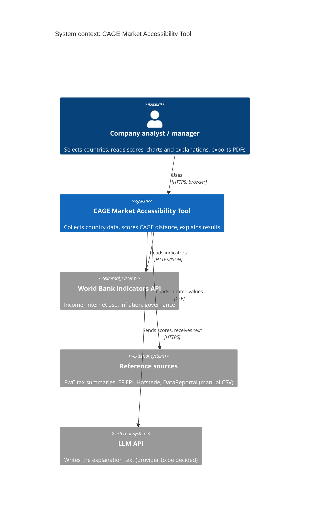

# Architecture

## System context (C4 level 1)

## Modules

The code is organised **by feature module, not by technical layer**. Each module owns its models, logic, routes and tests.

| Backend module (`backend/app/`) | Responsibility |
|---|---|
| `auth` | Single-user login, signed session cookie, login throttling |
| `profile` | Company profile and countries configuration |
| `sources` | World Bank client, manual CSV loader, timezone and Hofstede calculations, `collect` command |
| `evidence` | SQLite store of every raw value with its source |
| `scoring` | Pure scoring rules, dimension and Accessibility % aggregation, scorecard API |
| `comparison` | Multi-country comparison API |
| `explanation` | Provider-agnostic LLM port, numbers guard, explanation cache |
| `reports` | PDF report builder |

| Frontend feature (`frontend/src/features/`) | Responsibility |
|---|---|
| `health` | API status indicator |
| `auth` | Login page, protected shell, logout |
| `scorecard` | Country picker, indicators, dimensions, radar |
| `comparison` | Ranking and radar overlay |
| `explanation` | Explain panel |
| `report` | PDF export |
